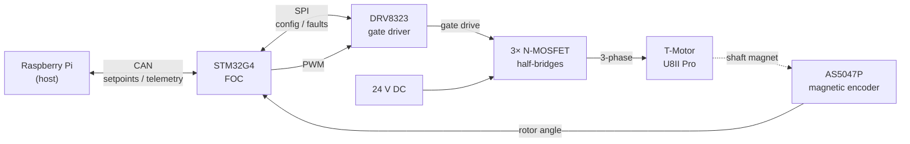

# Single-Axis BLDC / FOC Driver PCB

A single-axis BLDC motor driver board designed in **Altium Designer** for the joint actuators of a future version of the KOUDRUPED quadruped. It is sized to mount on the back of a **T-Motor U8II Pro** actuator.

> **Status:** design study, made to learn Altium Designer. The board has not been manufactured or tested, and no firmware has been written for it yet.

## Architecture

| Block | Part | Role |
|---|---|---|
| MCU | STM32G4 | Runs field-oriented control (FOC) |
| Gate driver | DRV8323 | Configured over SPI, reports faults |
| Power stage | N-channel MOSFET half-bridges | Drives the three motor phases |
| Position sensor | AS5047P magnetic encoder | Rotor angle for FOC |
| Communication | CAN | Setpoints from and telemetry to a Raspberry Pi host |

- **Input:** 24 V DC, targeting the 31 A peak current of the U8II Pro
- **Planned telemetry over CAN:** motor current, velocity, position and fault status
- **Stack-up:** 4 layers, with an internal ground reference plane
- **Heat:** thermal vias under the power stage

## Layout

  

<i>All four layers together.</i>

| Layer 1 – Top | Layer 2 – Inner |
|:---:|:---:|
|  |  |
| **Layer 3 – Inner** | **Layer 4 – Bottom** |
|  |  |

## Files

| Folder | Content |
|---|---|
| `altium/` | Project schematic |
| `media/` | Screenshots |

## What I'd change in the next revision

- Check current-sense and thermal design with calculations before routing
- Write and test FOC firmware on an STM32G4 development board first
- Order a first prototype and test it at low current
